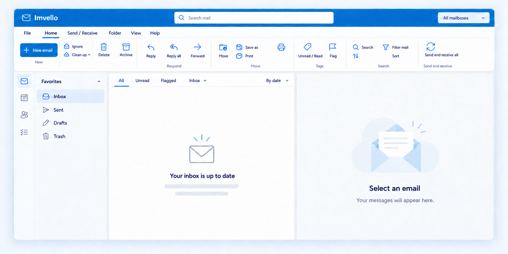

<p align="center">
  
</p>

<h1 align="center">Imvello</h1>

<p align="center">
  <strong>A little more calm in your inbox.</strong><br/>
  A thoughtful home for your email — bring your accounts, find your focus.
</p>

<p align="center">
  <a href="https://www.imvello.app">Website</a> ·
  <a href="#-get-imvello">Download</a> ·
  <a href="#-the-experience">Features</a> ·
  <a href="#-build-from-source">Build from source</a> ·
  <a href="#-a-few-good-questions">FAQ</a>
</p>

<p align="center">
  
  
  
  
</p>



<p align="center"><sub>Interface also available in <a href="docs/imvello-interface-es.png">Spanish</a> · <em>También disponible en <a href="docs/imvello-interface-es.png">español</a>.</em></sub></p>

---

## A new home for your email

Imvello is an email app for accessing **existing** email accounts. Keep your Gmail, Hotmail, or IMAP email service and use Imvello as your desktop client.

**Bring your accounts. Find your focus. Meet Imvello.**

### Bring your own inbox

Keep the email addresses people already know. Imvello is built for the services you use.

| Your account | What to expect |
| --- | --- |
| **Gmail** | A home for your Google email, from everyday conversations to the messages that matter. |
| **Outlook.com & Hotmail** | Bring your Microsoft email address along, including your familiar Hotmail account. |
| **IMAP accounts** | Use an IMAP-compatible provider or a custom-domain mailbox. Connection settings depend on your email service. |

## The experience

All your mail. A little more space.

- **A familiar workspace** — A ribbon toolbar brings actions such as composing, replying, archiving, and searching into one familiar workspace.
- **Room to read** — A message list and reading area sit side by side, giving conversations their own space.
- **A clear view of your mailboxes** — The folder sidebar keeps inboxes, sent messages, drafts, and deleted items close at hand.
- **Everyday actions, within reach** — New email, reply, archive, flag, sort, and send/receive are always one click away.

## Get Imvello

Download the **Imvello 1.0.0 Windows installer**, open it on your Windows computer, and follow the installer's instructions. Imvello supports Windows 10 (17763+) and newer, x64.

- 🌐 Download from the website: **[www.imvello.app](https://www.imvello.app)**
- 📦 Or grab the installer from [GitHub Releases](../../releases)

The installer and application executables are **Authenticode-signed** (SHA-256, timestamped), so Windows shows Imvello as the verified publisher instead of an "Unknown publisher" warning.

> **Note for other machines:** the release is signed with Imvello's own certificate. To show as verified outside machines that already trust it, install [`installer/ImvelloCodeSigning.cer`](installer/ImvelloCodeSigning.cer) into the *Trusted Root Certification Authorities* store (Current User).

## Build from source

**Prerequisites:** Windows 10+, the [.NET 10 SDK](https://dotnet.microsoft.com/download), and — only if you want the installer — [Inno Setup 6](https://jrsoftware.org/isdl.php).

```powershell
# Run the app
dotnet run --project src/Imvello

# Publish + build the signed installer into artifacts\
powershell -NoProfile -ExecutionPolicy Bypass -File installer\build-installer.ps1
```

`build-installer.ps1` publishes a self-contained single-file exe, signs it with the local `CN=Imvello` code-signing certificate (create it once with `installer\create-signing-cert.ps1`), compiles the Inno Setup installer, and signs the installer too.

## A project with an open future

As the project opens up, its source code, contribution guidelines, and development roadmap will give people a place to explore, share ideas, and contribute. This repository is that home.

## A few good questions

**Is Imvello an email provider?**
No. Imvello is an email app for accessing existing email accounts. Keep your Gmail, Hotmail, or IMAP email service and use Imvello as your desktop client.

**Where is the source code?**
Right here. The public repository lives in this repo; the license and contribution guidelines are on their way as the project opens up.

**What is stored on my computer?**
Your mail, accounts, and settings live locally in `%LOCALAPPDATA%\LetMail`. Uninstalling Imvello deliberately keeps that data, so reinstalling or upgrading never loses your mail.

---

<p align="center">
  <sub>Created by <strong>EdwardTech</strong> · <a href="https://www.imvello.app">www.imvello.app</a> · © 2026 All rights reserved.</sub>
</p>
